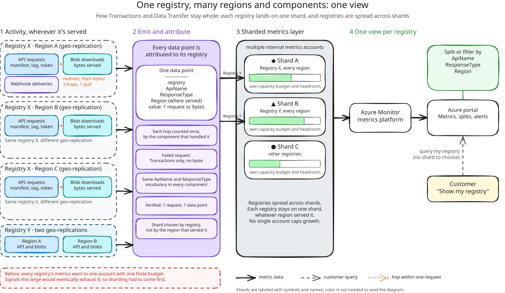
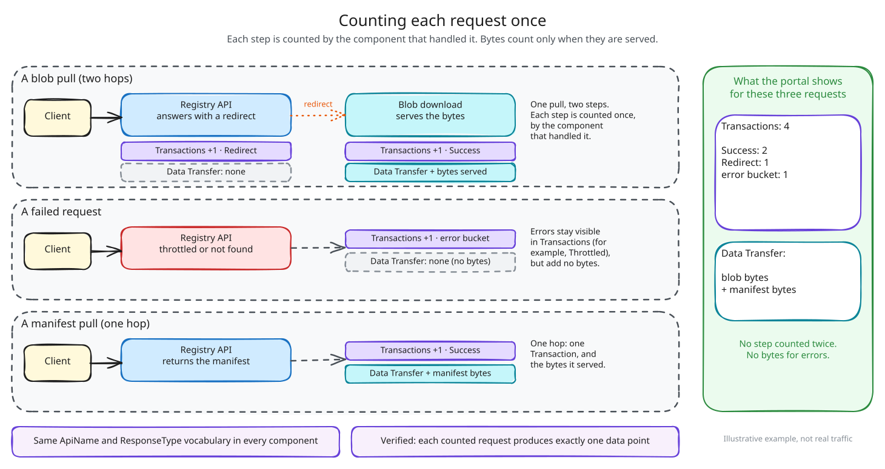
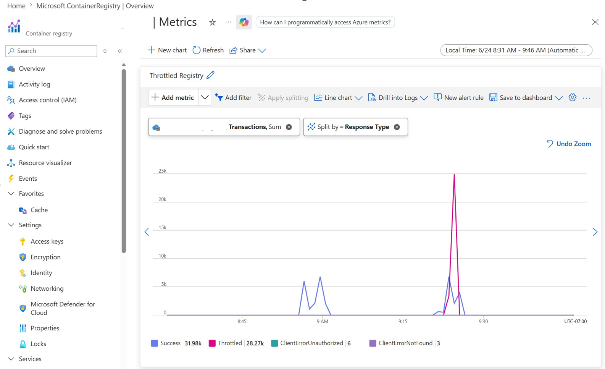

# Making Registry Activity Visible at Scale

> [!NOTE]
> This is a temporary public staging copy of an upcoming Azure Tech Community article by Caroline Barker. The final article will be published under Caroline's author profile.

Azure Container Registry (ACR) now publishes two new metrics: **Transactions** and **Data Transfer**. For the first time, you can see which operations your registry serves, which region serves them, and how much data (egress) they move, for each registry and each of its geo-replicas.

ACR often serves as a shared distribution point for containerized workloads. Build systems push container images and other artifacts, Kubernetes clusters pull images during deployments, and security and lifecycle tools scan artifacts throughout the day. As those environments grow, high-level signals such as a total pull count or storage used can tell you *that* activity changed, but not *why*. Transactions and Data Transfer fill that gap, so you can explain a traffic spike, catch a failing or throttled pipeline, and see where your data goes.

A customer-facing metric is a stream of data points, attributed to one resource, that you can chart, split, and alert on in Azure Monitor. Building these metrics meant producing data points for very high-throughput signals, counting them accurately, attributing each one to the right registry in every region, and not exhausting the metrics system underneath.

In this post, we'll cover what these metrics show you, what it took to deliver them at scale, and the sharded design that made it possible.

**Contents**

- [What you couldn't see before](#what-you-couldnt-see-before)
- [Why scale is the hard part](#why-scale-is-the-hard-part)
- [Sharding the metrics without splitting the view](#sharding-the-metrics-without-splitting-the-view)
- [What customers get](#what-customers-get)
- [Built for the metrics that come next](#built-for-the-metrics-that-come-next)
- [Conclusion](#conclusion)

## What you couldn't see before

Before this work, push and pull counts, alongside storage used, were the only registry traffic metrics we published. They showed *that* activity happened, but not *what kind* of operations drove it, *whether* each operation succeeded, or *where* it was served.

Take a sudden jump in pulls:

- **Before:** total pull count is up, with no way to tell which geo-replication drove the traffic.
- **Now:** the extra requests are blob downloads in one geo-replication region, many of them `Throttled`, while Data Transfer from that geo-replication stays flat.

Those gaps matter most when traffic changes. An increase may come from a deployment, a retry loop, metadata polling, a regional workload shift, or larger image layers, and each looks different underneath: a surge in manifest and blob reads, repeated errors or throttled responses, a steady stream of tag and listing calls, traffic moving between replicas, or more bytes per pull without more requests. To tell them apart, you need to know which operations are changing, how much artifact data is moving, where requests are being served, and whether the pattern matches the workload you intended to run.

Push and pull counts summarize outcomes. Transactions and Data Transfer describe behavior, and describing behavior takes far more data.

## Why scale is the hard part

These signals are high-throughput by nature, because every counted request becomes its own data point: a single sampled registry's activity can exceed 100,000 transactions and hundreds of gigabytes of data transferred (egress) in one hour.

All of those data points land in internal metrics accounts, and each account has a finite budget for how much data it can take in and process. Our previous emission strategy sent metrics to a single backing account. That worked for the metrics we already had, but signals this large would eventually exhaust that account's quota.

Scale wasn't an optimization we could add later. It was a prerequisite for launching these metrics at all.

## Sharding the metrics without splitting the view

The answer to the capacity problem is to stop relying on one account. Instead, we shard our metrics across multiple internal metrics accounts. A *shard* is one slice of a larger system that holds part of the data and has its own capacity. Each shard has its own headroom, which we monitor and manage independently, so no single account caps growth.

**Geo-replication complicates this.** A geo-replicated registry is served from many regions at once, and a single request can pass through more than one component: one answering API calls, another serving blob bytes, another delivering webhooks. However capacity is divided, every data point from every region and every component still has to be attributed to the registry it belongs to. Otherwise you'd see your registry's activity in pieces and have to stitch it back together yourself.

*Activity from every geo-replication and component is attributed to its registry and counted once. Each registry's metrics land on one shard, different registries are spread across shards, and you still query one registry in the portal.*

When you open the Azure portal or query Azure Monitor, you query your registry. You never see or choose where that information is coming from.

**Counting each request once.** Multi-hop requests raise the same question for accuracy. One blob pull can touch more than one component: the registry may answer with a redirect, and a different component serves the bytes. Each step is counted once, by the component that handled it: the redirect appears as its own `Redirect` transaction, the download as a `Success` transaction, and the bytes appear once in Data Transfer. Failed requests count as Transactions, so errors stay visible, but not as Data Transfer, because no bytes were delivered. Every emitting component uses the same `ApiName` and `ResponseType` vocabulary, and we verify that each counted request produces exactly one data point.

*Each step is counted once, by the component that handled it, and bytes count only when they're served.*

The result is one view of each registry, across every region and component, with each step of a request counted exactly once.

## What customers get

Both metrics appear where you already look: **Azure portal > your registry > Monitoring > Metrics**, and through Azure Monitor for programmatic queries and alerts.

**Transactions** counts registry API operations, with three dimensions:

- `ApiName`: the registry operation, such as manifest, tag, and blob operations, referrer and catalog listings, token requests, etc.
- `ResponseType`: `Success`, `Redirect`, `ClientErrorUnauthorized`, `ClientErrorNotFound`, `Throttled`, etc.
- `Region`: the geo-replication of the registry that served the request

**Data Transfer** reports the total outbound data your registry transfers, in bytes, when it serves content such as blob and manifest downloads. You can split it by `ApiName` and `Region`.

- `ApiName`: the flow that moved the data, such as layer downloads, manifest downloads, image imports, replicating content to your geo-replicas, etc.
- `Region`: the geo-replication of the registry that served the request

A typical investigation takes a few steps. Open **Monitoring > Metrics**, choose **Transactions**, and split by `ResponseType` to see successes, redirects, throttling, and errors at a glance. Switch the split to `Region` to see which geo-replication is serving the change. Then select **New alert rule** from the same chart. For example, filter to `Throttled` and alert when the total over 5 minutes exceeds a threshold you choose.

To understand egress by region, chart Data Transfer over time and split it by `Region` to see how much data each geo-replication serves and whether that data transfer traffic is growing.

Match the view to what you suspect:

- **A deployment or metadata polling:** split Transactions by `ApiName` to see whether blob and manifest reads or tag and listing calls are driving the change.
- **A retry loop:** filter `ResponseType` to `Throttled`, `ClientErrorUnauthorized`, or `ServerErrorOther`.
- **A regional workload shift:** split either metric by `Region`.
- **Larger image layers:** compare the two metrics. Data Transfer rising while Transactions stays flat points to bigger artifacts, not more requests.

*Transactions split by ResponseType: successes, redirects, throttling, and errors at a glance.*

## Built for the metrics that come next

Transactions and Data Transfer run on the same sharded metrics path, and we built it so future metrics onboard onto that same path instead of competing for one account's capacity. The design scales with customer workloads and with the metrics we add next, without a redesign.

## Conclusion

Transactions and Data Transfer give you a direct view of what your registry is doing: which operations it serves, whether they succeed, where they're served, and how much data moves. Sharding is how we delivered that view at scale without giving up accuracy, and it's the path future metrics will onboard onto.

A few lessons generalize beyond metrics:

- **Design for scale before you launch a high-throughput signal, not after.**
- **Attribute by resource, not by location.** Activity spread across many regions still needs one source of truth per resource.
- **Keep the complexity on the service side.** Customers query a registry, not a shard, so how we manage capacity can evolve without changing what you query.

Get started with Transactions and Data Transfer in [Monitor Azure Container Registry](https://learn.microsoft.com/azure/container-registry/monitor-service) and the [supported metrics reference for Azure Container Registry](https://learn.microsoft.com/azure/azure-monitor/reference/supported-metrics/microsoft-containerregistry-registries-metrics).

## Acknowledgements

Written by Caroline Barker with contributions from the Azure Container Registry team.
